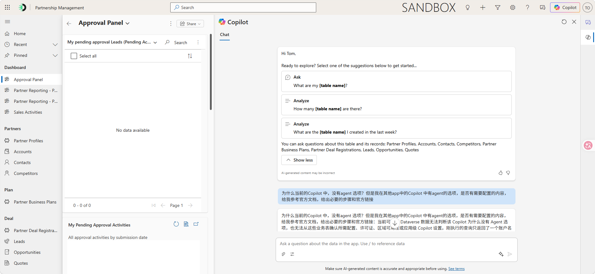
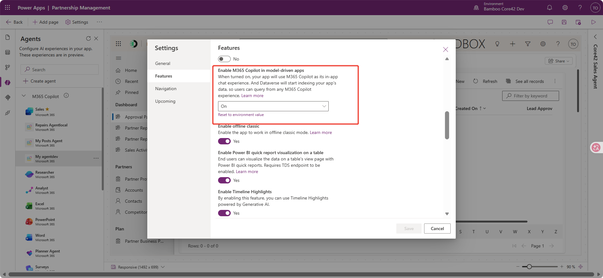
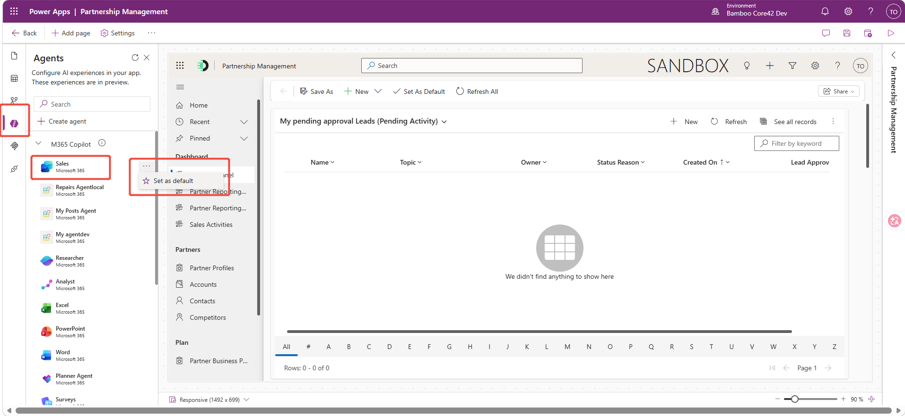
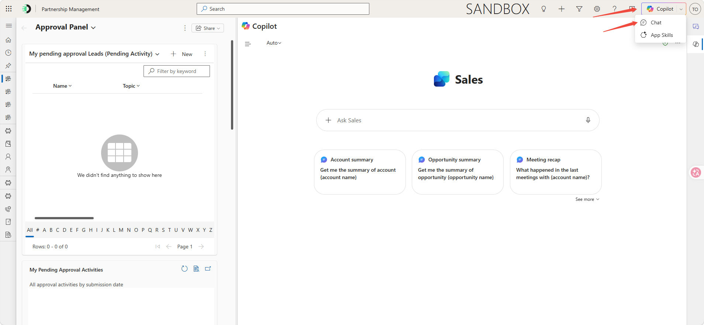
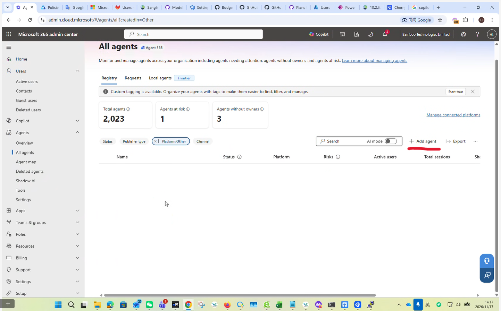
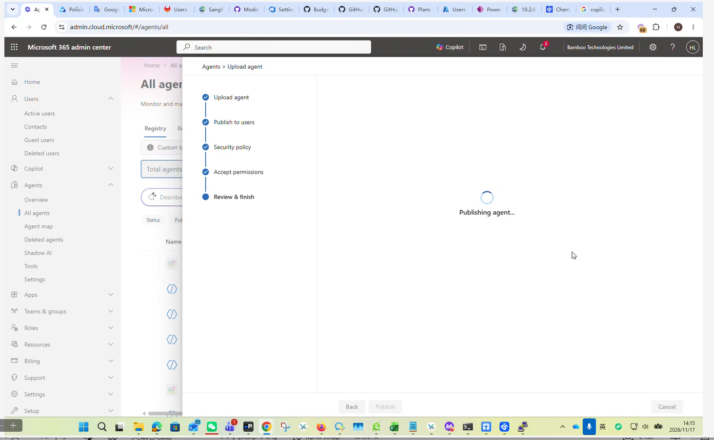
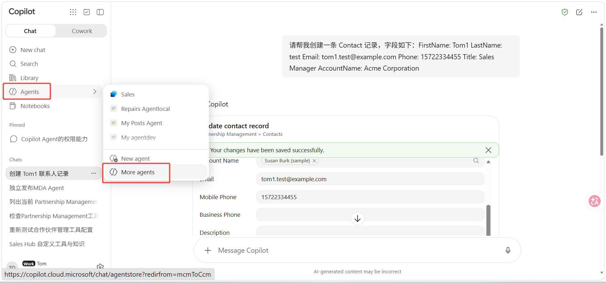
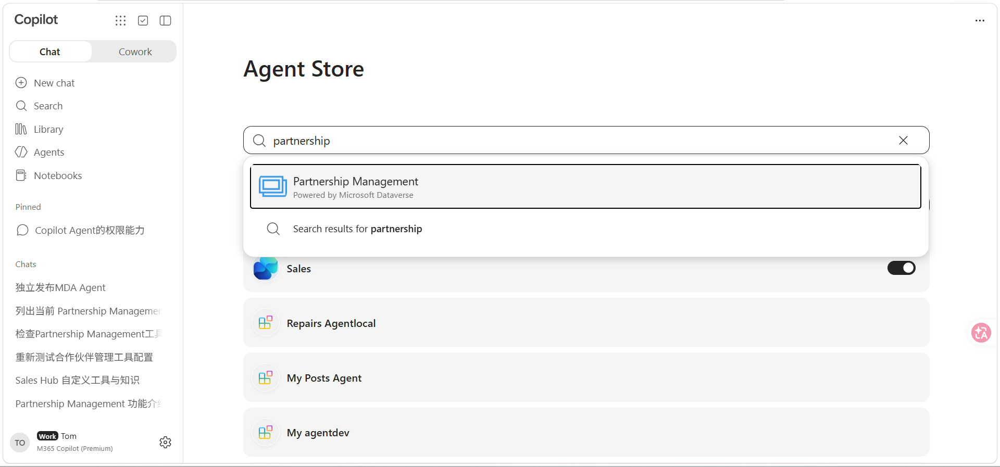
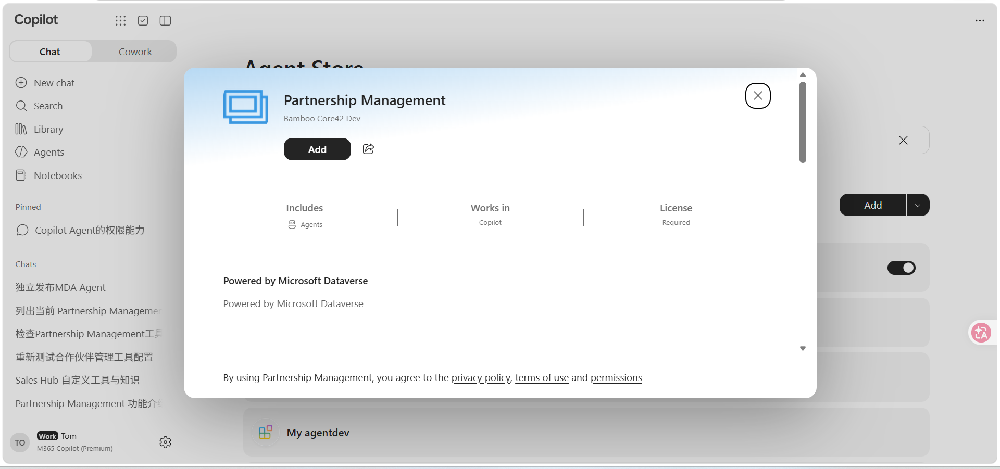
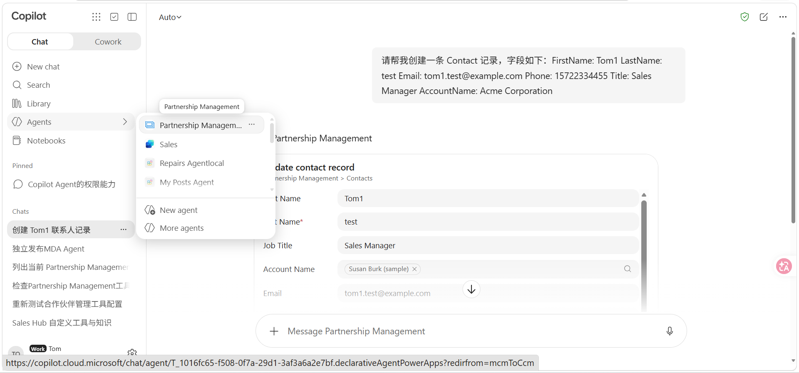

# 使用Copilot Chat
## 无法Copilot Chat
打开https://m365.cloud.microsoft/chat 显示：
Copilot Chat isn't available
Chat blocked illustration
Copilot Chat isn't available in your region. You can still use Search and Apps.
也找不到创建的agent

### 解决：需确定账户是否被分配有效的 Microsoft 365 Copilot 许可证

最终原因：需要获得有效的 Microsoft 365 Copilot Service License

# 在MDA中为应用用户添加 Microsoft Copilot
## MDA 中可以看到 Copilot，但是只有Skill 功能

### 启用 M365 Copilot in model-driven apps
1. 打开MDA 编辑模式
2. 打开Setting
3. 选择Feature 栏（需要一些时间等待该页内容加载出来）
4. 找到 Enable M365 Copilot in model-driven apps
5. 下拉选择 On

6. 点击Save
   
### 将 Sales Agent 作为默认Agent（可选）
1. 在左边栏打开 Agents 栏
2. 下拉 MS365 Copilot
3. 将 Sales Agent 作为默认 Agent

### Pulish 并刷新MDA
1. 点击页面右上角的 publish
2. 确认 publish 之后重新打开该MDA，多次刷新
### 在Copilot 处选择 Chat
当Copilot 图标处出现下拉箭头时，下拉选择Chat
侧边栏和Agent 已经可用

# 使用上传的Agent
https://learn.microsoft.com/en-us/microsoft-agent-365/admin/agent-registry-overview#upload-custom-agent
## 上传并部署Agent
1. 打开 **Microsoft 365 管理中心** https://admin.microsoft.com/
2. 选择 **Agents** → **All Agents** → **+ Add agent**。
      
3. 点击 **Choose File**，选中要上传的 ZIP 包。
4. 系统验证通过后，确认 agent 名称、图标和宿主产品，点击 **Next**。
5. 指定可用的用户（建议先选择 **Just me** 或小范围测试组），点击 **Next**。
6. 审阅权限与能力，点击 **Next**，最后选择 **Finish deployment** 完成上传。
   

## 上传Agent 后未看到该Agent
在 https://admin.microsoft.com/ 中上传并部署完成自定义agent之后，要直接使用该Agent，但未在Agents 中未看到该agent。
>需要将该Agent 添加到应用中：
### 在Agents 下，打开 More Agents

### 搜索你上传和部署的Agent

### 添加该Agent

### 在Agents 中打开该Agent 使用
