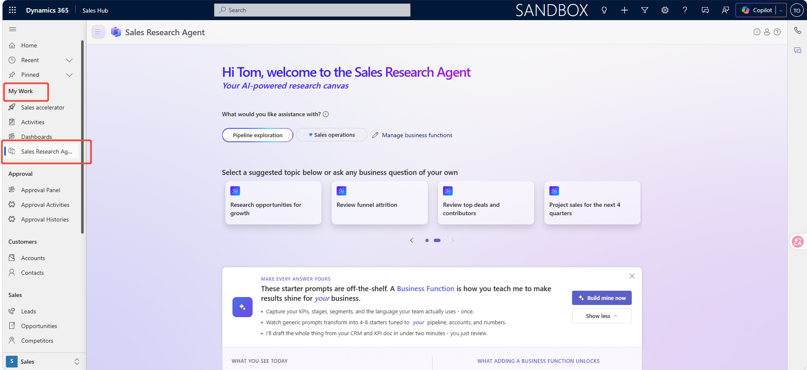
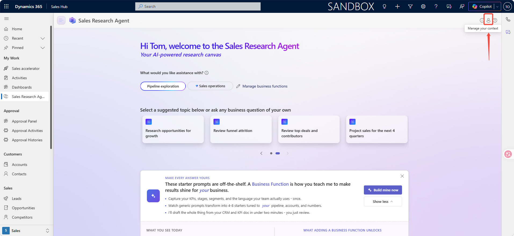
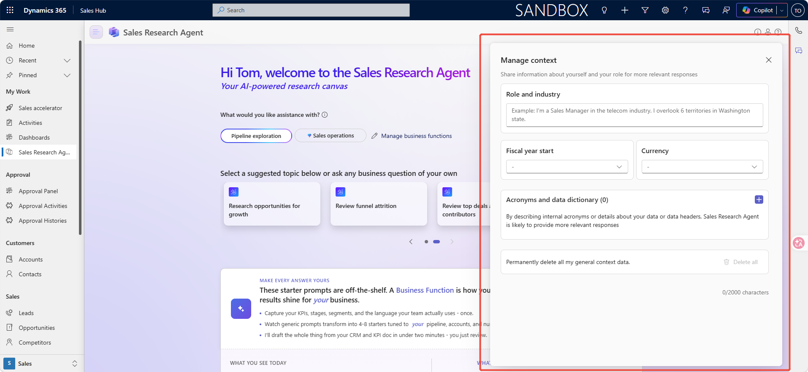

# Sales Research Agent 是什么？
Dynamics 365 Sales中的Sales Research Agent通过自然语言与数据对话，为你提供解决复杂的业务问题的能力。它为你提供丰富的销售数据洞察，助你在考虑众多变量时做出明智决策。
你可以向agent提供general 和 business 背景，以提升内容的相关性和一致性。
参考文档：https://learn.microsoft.com/zh-cn/dynamics365/sales/sales-research-agent

# Sales Research Agent 可以做什么？
- 获取您的 Dynamics 365 Sales 数据、Microsoft Fabric Lakehouse 以及离线文件（CSV、Excel 或 PDF）的洞察，帮助您做出明智的决策。 该代理专门回答管道勘探和销售运营等领域的战略业务问题。
- 利用研究蓝图，其中包含代理的研究摘要、关键发现和建议的后续步骤，这些步骤基于你提供的业务上下文和数据。
- 使用自然语言与研究结果进行交互。 提出后续问题、更改可视化效果，并向研究添加更多数据。

# Sales Research Agent 不能做什么？不适合做什么？

# 提供context以增强销售研究代理
通过添加上下文和说明，你可以提升销售研究代理生成内容的相关性和实用性。代理会自动将这些信息应用到提示中，这样你就不必每次重复。
你可以提供两种context：General context 和 Business function。
## General context
不论agent 研究哪个主题，都要相关的信息。
这包括你的职位、行业、财政年度和货币信息。
### 为代理设定General context
1. 在Sales Hub网站，进入 `My Work > Sales Research Agent`
   

2. 在页面右上角，选择人像图标 `Manage your context`
      
      
- 输入涵盖你的职位、行业、财政年度和货币的背景信息。这些信息帮助客服更好地理解您的业务和角色，并调整洞察内容使其更贴合您的需求。
- 在`Acronyms and data dictionary` 部分，添加组织在上下文中使用的数据的首字母缩略语或列标题定义。
当缩写出现在提示中或出现在你上传的数据或数据源中时，代理可以正确解读其含义并返回更好的结果。
- 要随时永久删除一般上下文信息，请在页面底部选择 `Delete all`。

## Business function
是什么：为代理提供仅适用于特定用例的角色、上下文和指令。
Business function 向Sales Research Agent 介绍您的组织在某一用例中的运作方式，如账户规划、区域规划、管道审查或参与分析。它包含重要的表格和关系、代理遵循的业务规则和度量定义，以及用户最常提出的问题。

何时创建 Business function：
- 你需要定义自定义字段或逻辑。
- 你希望对数据的展示或解读有更多控制权。
- 你需要将自己的商业知识应用于洞察的生成和呈现方式，同样要考虑具体的使用场景。

### 使用 Business Function Builder 创建业务功能
谁负责什么：
| Role |	他们的作用|
|----|----|
| Maker（销售运营、收入运营，或了解你Dynamics 365数据的管理员）|	创建业务函数，评估它，添加起始提示，编写默认蓝图，并分享业务函数。|
|用户 （卖家、客户经理或销售主管）|	选择一个业务职能和一个启动提示，并从自己的数据中获得答案。 不需要设置。|

中文教程：https://learn.microsoft.com/zh-cn/dynamics365/sales/sales-research-agent-business-function-builder-create#validate-the-business-function
英文教程：https://learn.microsoft.com/zh-cn/dynamics365/sales/sales-research-agent-business-function-builder-create#validate-the-business-function

### 评估 Business Function
中文教程：https://learn.microsoft.com/zh-cn/dynamics365/sales/sales-research-agent-business-function-builder-evaluate
英文教程：https://learn.microsoft.com/zh-cn/dynamics365/sales/sales-research-agent-business-function-builder-evaluate

### 创建和管理起始提示词
中文教程：https://learn.microsoft.com/zh-cn/dynamics365/sales/sales-research-agent-starter-prompts

1.Confirm tables to explore. Review the detected tables. Remove any that aren't relevant, or add more before exploring starts.
2.Exploring table relationships.The builder is tracing connected records and uncovering paths across your selected data.
