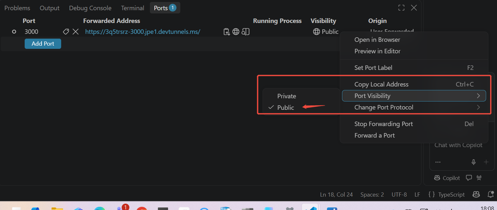

以下是结合本次全部对话整理的完整文档，涵盖架构背景、配置步骤、问题排查以及生产部署建议。

---

# 通过声明式代理与 MCP 服务器实现 Sales Agent 的 Teams 会议预约功能

## 1. 架构概述

本方案使用 **Microsoft 365 Agents Toolkit** 在 Visual Studio Code 中创建了一个 **Declarative Agent**，并通过 **Model Context Protocol（MCP）** 连接到一个开源的 **Teams MCP Server**，使 Copilot 能够以自然语言调用 Teams 会议创建能力。

整体链路如下：

```
用户（.net 账号） → Copilot Chat → Declarative Agent → MCP Server（本地运行） → Microsoft Graph API → Teams 会议
```

该链路中涉及**两个独立的 Microsoft Entra ID 应用注册**，分别承担不同的认证职责（详见第 3 节）。

**参考文档**：
- Microsoft 365 Developer Blog: *Build declarative agents for Microsoft 365 Copilot with MCP*
- Microsoft Learn: *Configure authentication for MCP and API plugins in agents in Microsoft 365 Copilot*


## 2. 项目背景与组件说明

### 2.1 声明式代理（Declarative Agent）

在 VS Code 中通过 **Microsoft 365 Agents Toolkit** 创建了一个 Declarative Agent。Agents Toolkit 提供了图形化向导，用于将代理连接到 MCP 端点。

### 2.2 MCP 服务器

使用 GitHub 开源项目 **`adkins-amdg/teams-mcp-server`** 作为 MCP 服务器。该服务器通过 **Microsoft Graph API** 以 **delegated（委托）权限** 访问 Teams，并支持通过 **device-code flow** 进行用户认证，默认以 **stdio** 模式在本地运行。

该服务器提供的会议相关工具包括 `teams_create_meeting`、`teams_list_events`、`teams_get_event` 等。

**项目链接**：`https://github.com/adkins-amdg/teams-mcp-server`

### 2.3 两个 Entra ID 应用注册的分工

| 应用名称 | 类型 | 用途 | 认证流程 |
| :--- | :--- | :--- | :--- |
| **`Teams MCP (delegated)`** | Public Client（公共客户端） | MCP 服务器**直接调用 Microsoft Graph API** 时使用的身份 | Device-code flow（设备代码流） |
| **`Copilot-MCP-Client`** | Confidential Client（机密客户端，需 Client Secret） | **Microsoft 365 Copilot 运行时**连接到你的 MCP 服务器时使用的身份 | OAuth 2.0 Authorization Code Flow |

**为什么需要两个应用？**
- `Teams MCP (delegated)` 是**公共客户端**，不支持 Client Secret，专为设备代码流设计，用于本地交互式登录。
- `Copilot-MCP-Client` 是**机密客户端**，需要 Client Secret，专为 Copilot 运行时通过 OAuth 2.0 授权码流程获取令牌而设计。两者的安全模型和客户端类型互不兼容，因此必须分开创建。

**参考文档**：
- Microsoft Learn: *Configure authentication for MCP and API plugins in agents in Microsoft 365 Copilot*（支持 OAuth 2.0 授权码流程和动态客户端注册等方案）


## 3. 配置步骤

### 3.1 创建 `Teams MCP (delegated)` 应用注册

1. 登录 **Azure Portal** → **Microsoft Entra ID** → **应用注册** → **新注册**。
2. 名称设为 `Teams MCP (delegated)`，账户类型选 **“仅此组织目录中的账户”**。
3. 在 **“身份验证”** 页面，开启 **“允许公共客户端流”（Allow public client flows）**，这是设备代码流所必需的。
4. 在 **“API 权限”** 中添加以下 **Microsoft Graph 委托权限**（根据实际需求裁剪）：
   - `User.Read`
   - `Calendars.ReadWrite`
   - `OnlineMeetings.ReadWrite`
   - `offline_access`
   - （如需要搜索成员，可添加 `Team.ReadBasic.All`、`Channel.ReadBasic.All` 等）
5. 点击 **“代表 [租户] 授予管理员同意”**。其中 `ChannelMessage.Read.All` 和 `TeamMember.Read.All` 等 `.All` 权限必须由管理员授予同意。
6. 记录 **Application (client) ID** 和 **Directory (tenant) ID**。

### 3.2 安装并构建 MCP 服务器

```cmd
git clone https://github.com/adkins-amdg/teams-mcp-server.git
cd teams-mcp-server
npm install
npm run build
```

### 3.3 配置环境变量

**Windows CMD 中复制 `.env` 文件**（不要使用 `cp`，CMD 不支持）：

```cmd
copy .env.example .env
```

编辑 `.env`，填入：

```env
TEAMS_MCP_CLIENT_ID=<你的 Application (client) ID>
TEAMS_MCP_TENANT_ID=<你的 Directory (tenant) ID>
```

**关键补充**：该项目的源码默认**没有加载 `dotenv`**。为确保 `.env` 文件生效，需要在 `src/index.js` 的**第一行**添加：

```javascript
import 'dotenv/config';
```

然后重新构建：

```cmd
npm install dotenv
npm run build
```

### 3.4 登录 MCP 服务器（设备代码流）

```cmd
npm run login
```

浏览器中打开提示的地址并输入设备代码，用 `.net` 账号完成登录。令牌缓存会保存到 `~/.teams-mcp-token-cache.json`，后续 Graph API 调用会静默读取缓存。

### 3.5 使用桥接工具将 stdio 转为 HTTP

由于 Agents Toolkit 的 `RemoteMCPServer` 类型要求一个**可访问的 HTTP 端点**，而该 MCP 服务器默认以 stdio 模式运行，需要使用 `supergateway` 将其包装为 HTTP 服务：

```cmd
npx -y supergateway --stdio "node dist/index.js" --port 3000
```

执行成功后，本地 `http://localhost:3000` 即可提供 MCP 服务。

### 3.6 使用 Dev Tunnel 暴露公网 HTTPS URL

在 VS Code 的 **Ports** 面板中，手动转发 `3000` 端口，并将可见性设为 **Public**。VS Code 会生成一个类似 `https://xxxx-3000.devtunnels.ms` 的 HTTPS 地址。你的 MCP 远程端点即为：

```
https://xxxx-3000.devtunnels.ms/mcp
```

Dev Tunnels 是 Microsoft 官方推荐的隧道服务，内置于 VS Code 和 Agents Toolkit 中。

### 3.7 创建 `Copilot-MCP-Client` 应用注册

1. Azure Portal → **应用注册** → **新注册**。
2. 账户类型选 **“仅此组织目录中的账户”**。
3. 在 **“身份验证”** 页面，添加平台 **“Web”**，重定向 URI 设置为：
   ```
   https://teams.microsoft.com/api/platform/v1.0/oAuthRedirect
   ```
4. 在 **“证书和密码”** 中创建一个 **Client Secret**，记录密码值。
5. 在 **“API 权限”** 中，仅为该应用授予**最小必要权限**（如 `User.Read`、`offline_access`），**不需要**添加 `TeamSettings.*` 等权限。该应用仅负责 Copilot 运行时到 MCP 服务器这一跳的认证。
6. 记录 **Client ID** 和 **Client Secret**。

### 3.8 在 Agents Toolkit 中配置 MCP Action

1. 在 Agents Toolkit 侧边栏中，选择 **Add Action** → **Start with an MCP server**。
2. 输入 MCP Server URL：`https://xxxx-3000.devtunnels.ms/mcp`。
3. 认证类型选择 **`OAuth (with static registration)`**。
4. 填入 `Copilot-MCP-Client` 的 **Client ID** 和 **Client Secret**。
5. 工具包会生成 `ai-plugin.json`、`declarativeAgent.json` 等清单文件。

### 3.9 修正 `ai-plugin.json` 的 `runtimes` 配置

确保 `ai-plugin.json` 的 `runtimes` 部分包含以下内容（**不要**包含 `enable_dynamic_discovery` 字段，该字段已被弃用）：

```json
"runtimes": [
  {
    "type": "RemoteMCPServer",
    "spec": {
      "url": "https://xxxx-3000.devtunnels.ms/mcp"
    },
    "run_for_functions": ["*"],
    "auth": {
        "type": "OAuthPluginVault",
        "reference_id": "${{MCP_DA_AUTH_ID_3Q5TRSRZ30}}"
    }
  }
]
```

### 3.10 补充 `m365agents.yml` 中的 OAuth 端点

工具包可能无法自动发现 OAuth 元数据。打开 `m365agents.yml`，将 `oauth/register` 动作中的占位符替换为 Microsoft Entra ID 的 OAuth 2.0 端点：

```yaml
- uses: oauth/register
  with:
    name: oauth2-auth-code
    flow: authorizationCode
    authorizationUrl: https://login.microsoftonline.com/{你的租户ID}/oauth2/v2.0/authorize
    tokenUrl: https://login.microsoftonline.com/{你的租户ID}/oauth2/v2.0/token
    # ... 其他字段
```

### 3.11 递增版本号并 Provision

打开 `appPackage/manifest.json`，将 `version` 字段提升（如从 `1.0.0` 改为 `1.0.1`），保存后点击 **Provision**。

### 3.12 测试

Provision 成功后，点击 **Debug in Copilot** 进行测试。确保 `supergateway` 进程和 Dev Tunnel 保持运行。用自然语言下达指令，例如：

> “帮我为 Lead 张三预约一个明天下午 2 点的 Teams 会议。”


## 4. 已知问题：会议链接未生成

### 4.1 问题现象

通过 MCP 的 `teams_create_meeting` 工具创建事件后，邮件发送成功，但**返回内容中没有 `joinUrl`**，邮件中也没有 Teams 会议链接。

### 4.2 代码层面分析

`meetings.ts` 的代码逻辑是正确的，已包含 Graph API 创建 Teams 会议所需的两个核心参数：

```javascript
isOnlineMeeting: true,
onlineMeetingProvider: "teamsForBusiness",
```

### 4.3 根因分析

**根因是 `.net` 账号缺少 Teams 许可证（Teams license）**。

Microsoft Graph API 的在线会议创建端点（`/me/onlineMeetings` 或带 `isOnlineMeeting` 的事件创建）**仅支持拥有有效 Microsoft 365 许可证（包含 Teams 服务）的工作/学校账户**。个人 Microsoft 账户（如 `.com`）明确**不受支持**。即使认证成功，如果账户没有 Teams 许可证，Graph API 也会静默忽略 `isOnlineMeeting` 参数，退化为普通日历事件。

此外，部分案例表明，缺少 `TeamSettings.Read.All` 和 `TeamSettings.ReadWrite.All` 权限也可能导致 `isOnlineMeeting` 被忽略。但**许可证问题是根本前提**——权限再完整，没有 Teams 许可证也无法创建 Teams 会议。

### 4.4 解决方向

1. **联系管理员**：确认 `.net` 账号是否被分配了**包含 Teams 服务的 Microsoft 365 许可证**。如果没有，需要添加或更换许可证。
2. **检查 Teams 会议策略**：管理员需在 Teams 管理中心确认分配给 `.net` 账号的会议策略**允许创建私人会议**。
3. **补充权限**：在 `Teams MCP (delegated)` 应用的 API 权限中添加 `TeamSettings.Read.All` 和 `TeamSettings.ReadWrite.All`，并授予管理员同意。
4. **重新登录**：权限变更后，**删除** `~/.teams-mcp-token-cache.json`，重新执行 `npm run login`。
5. **重启服务**：重启 `supergateway` 进程，确保加载新的令牌缓存。

**参考文档**：
- Microsoft Q&A: *Graph API fails to create Teams online meeting*（明确说明个人账户不支持，工作/学校账户需有 Teams 许可证）


## 5. MCP URL 的本地运行与生产部署

### 5.1 当前 URL 是本地运行的吗？

**是的。** 当前 MCP 服务器通过 `supergateway` 运行在你的本地电脑上，并通过 **Dev Tunnel** 暴露为一个临时的公网 HTTPS URL（如 `https://xxxx-3000.devtunnels.ms/mcp`）。Dev Tunnel 的作用是将本地端口映射为公网可访问的地址，以便 Copilot 运行时能够调用它。

### 5.2 关闭电脑后，其他人还能用吗？

**不能。** 当前架构完全依赖你的本地电脑：

- `supergateway` 进程需要保持运行；
  ```
  npx -y supergateway --stdio "node dist/index.js" --port 3000
  ```
- `node dist/index.js`（MCP 服务器）需要保持运行；
- Dev Tunnel 需要保持活跃。
- 

一旦关闭电脑或终止这些进程，Copilot 将无法连接到 MCP 服务器，功能随之不可用。

### 5.3 这是否只是测试环境？

**是的。** 当前的本地运行 + Dev Tunnel 方案是**开发与测试阶段**的标准做法。Dev Tunnels 是 Microsoft 推荐的本地调试隧道工具，但**不适合生产环境**——它依赖于你的本地机器持续在线，且公网可达性受限于你的网络环境。

### 5.4 生产环境的最佳实践

要让所有用户都能稳定使用该功能，需要将 MCP 服务器**部署到云端的持久化托管环境**中。推荐的路径如下：

**方案：将 MCP 服务器部署到 Azure 托管服务**

1. **容器化 MCP 服务器**：将 `teams-mcp-server` 打包为 Docker 镜像（或直接使用 Azure App Service 的代码部署）。
2. **部署到 Azure App Service 或 Azure Container Apps**：
   - Azure App Service 支持代码部署，并与 Microsoft Entra ID 集成用于认证。
   - Azure Container Apps 适合容器化部署，支持 Dapr 和自动扩缩容。
3. **配置持久化 OAuth 认证**：
   - 将 `Copilot-MCP-Client` 的重定向 URI 配置为生产环境的 HTTPS 地址。
   - 在 `ai-plugin.json` 中更新 MCP 服务器的 URL 为生产域名（如 `https://mcp.yourdomain.com/mcp`）。
4. **使用持久化令牌缓存或服务主体**：
   - 生产环境不应依赖本地 `~/.teams-mcp-token-cache.json`。
   - 考虑使用 **Application Permissions（应用程序权限）** 配合**应用程序访问策略（Application Access Policy）**，指定一个有 Teams 许可证的用户作为组织者，由应用代表该用户创建会议。这要求管理员在 Teams 管理中心创建策略并授权。
5. **在 Microsoft 365 管理中心发布代理**：
   - 在 Agents Toolkit 中执行 `Publish`，将代理提交到组织目录。
   - 管理员在 Microsoft 365 管理中心的 **Agents → Requests** 中审批通过。
   - 通过 **Agents → All agents → Sales → Custom tools & knowledge → Choose agent** 将代理能力扩展给 Sales Agent。

**关键提醒**：无论采用何种部署方式，**执行会议创建的身份（`.net` 账号或其他被代理的用户）必须拥有有效的 Microsoft 365 许可证（包含 Teams 服务）**。这是 Graph API 的硬性要求，无法通过技术手段绕过。

**参考文档**：
- Microsoft Learn: *Host an MCP server on Azure App Service, secured with OAuth*（Azure App Service 官方 MCP 托管指南）
- Microsoft Learn: *Debug MCP and API plugins locally*（Dev Tunnels 调试与生产部署的区别）
- GitHub: *Exposing Your Local App with a Tunnel*（Dev Tunnels 的持久化与临时 URL 说明）


## 6. 总结

| 维度 | 当前状态（开发/测试） | 生产环境要求 |
| :--- | :--- | :--- |
| MCP 服务器位置 | 本地电脑 + Dev Tunnel | Azure App Service / Container Apps |
| URL 持久性 | 临时，依赖本地进程 | 持久化域名 |
| 用户可用性 | 仅限本地开发者 | 组织内所有授权用户 |
| 认证方式 | 设备代码流 + OAuth 静态注册 | 应用程序权限 + 应用程序访问策略（或持久化 OAuth） |
| 会议创建前提 | `.net` 账号需有 Teams 许可证 | 执行身份必须有 Teams 许可证 |

**.net 账号缺少 Teams 许可证是当前会议链接无法生成的根本原因**。在解决许可证问题之前，任何配置调整都无法让 Graph API 返回 `joinUrl`。建议优先联系 IT 管理员为 `.net` 账号分配包含 Teams 服务的 Microsoft 365 许可证，然后再推进生产部署。